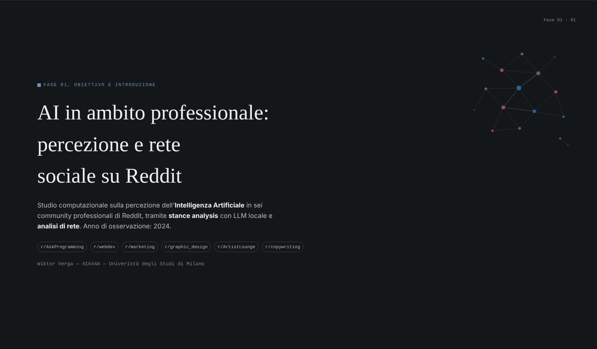
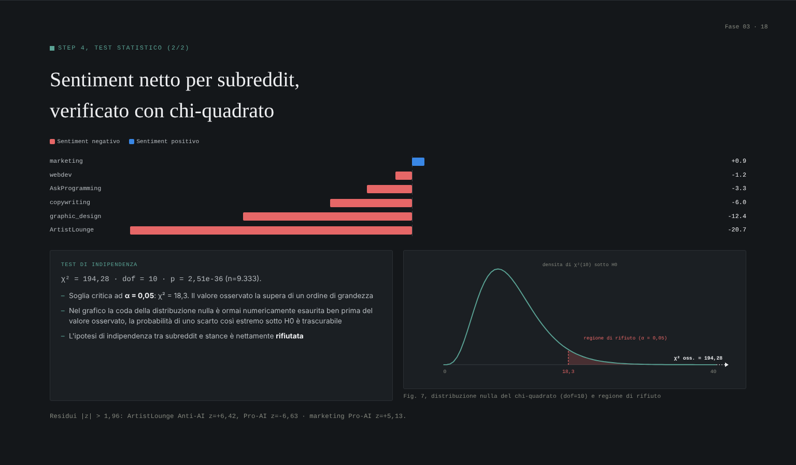
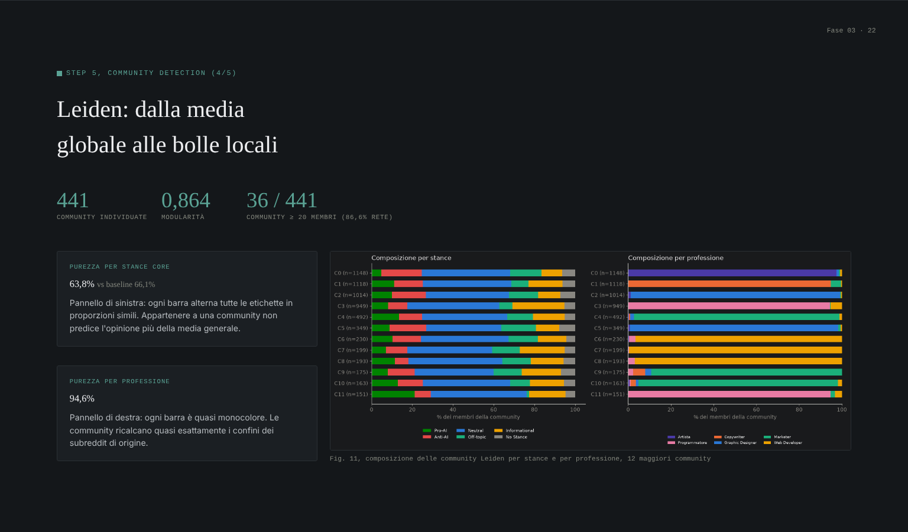

# AI at Work on Reddit · Stance and Network Analysis

**How do professionals talk about AI? A computational study of six professional communities on Reddit, combining LLM-based stance analysis with social network analysis.**

The project collects a full year of Reddit discussions (2024) from six subreddits tied to specific jobs, classifies every comment's stance towards AI with a locally run LLM, and builds a user network to check whether opinions and professions form separate bubbles.

**Interactive report:** [wiktorverga.github.io/Progetto-SMM](https://wiktorverga.github.io/Progetto-SMM/) (source in [`docs/index.html`](docs/index.html))


<p align="center">
  
</p>
<p align="center">
  
  
</p>

---

## Research questions

1. Is the discussion about AI mostly optimistic or pessimistic?
2. Does the perception of AI change across professions?
3. Who sees AI as a threat and who as an opportunity?
4. Do users who share a stance form **echo chambers**, or is there **cross-pollination**?
5. Do different professions share discussions, or do they live in separate bubbles?

## Data

| | |
|---|---|
| **Subreddits** | r/AskProgramming, r/webdev, r/marketing, r/graphic_design, r/ArtistLounge, r/copywriting |
| **Period** | 1 January – 31 December 2024 |
| **Source** | Monthly dumps from [Arctic Shift](https://github.com/ArthurHeitmann/arctic_shift) (posts and comments as `.jsonl`) |
| **Filtering** | Posts matching AI-related keywords (AI, ChatGPT, Copilot, Midjourney, LLM, automation, job loss…), first-level comments only, bots and `[deleted]` / `[removed]` content excluded |
| **Sampling** | Bottleneck sampling: every subreddit contributes the same number of comments, so professions are compared fairly |
| **Size** | ≈15,000 classified comments |

Raw dumps and generated CSV files are not committed (see `.gitignore`).

## Method

1. **Collection and cleaning.** `src/data_retrive.py` reads the dumps, keeps AI-related posts and their first-level comments, and drops bots and removed content.
2. **Balanced sampling** across the six subreddits.
3. **Zero-shot stance analysis** with [`google/gemma-4-E4B-it`](https://huggingface.co/google/gemma-4-E4B-it) running locally through Hugging Face Transformers on a CUDA GPU: instruction-tuned prompt, controlled generation, robust parsing with a fallback label and a checkpoint system to resume long inference runs.
4. **Qualitative validation.** Manual annotation of a stratified sample revealed that the original "Neutral" class was a catch-all, so the taxonomy grew from 3 to 6 labels: *Pro-AI, Anti-AI, Neutral, Off-topic, Informational, No Stance*.
5. **Statistics.** Stance distribution per subreddit and a chi-square test of independence between profession and stance.
6. **Network analysis.** Bipartite user–post graph projected onto users (co-commenting), connected components and degree, assortativity by stance and by profession, community detection with **Leiden** and bridge users by betweenness centrality.

## Key findings

- **RQ1:** among the comments that express a stance (≈9,300), 66.1% are genuinely ambivalent, 20.6% Anti-AI and 13.4% Pro-AI. The discussion leans pessimistic (net sentiment −7.2 points) but is not polarised.
- **RQ2:** perception does depend on the profession: the chi-square test rejects independence between subreddit and stance (χ² = 194.3, dof = 10, p < 10⁻³⁵).
- **RQ3:** net sentiment ranges from +0.9 in r/marketing to −20.7 in r/ArtistLounge. Visual and creative communities (r/ArtistLounge, r/graphic_design) are the most Anti-AI, since generative image tools threaten to replace their output; marketers see AI as a tool to optimise their work; the technical communities sit close to neutral.
- **RQ4:** inside each community Pro, Anti and Neutral users mix in the same proportions as the whole network: **no opinion echo chambers**.
- **RQ5:** Leiden communities almost exactly match the original subreddits (94.6% profession purity): **professions live in separate bubbles**, connected by a few bridge users.

The segregation is by profession, not by opinion about AI.

## Tech stack

| Area | Libraries |
|---|---|
| Data | pandas, zstandard, requests |
| LLM inference | PyTorch (CUDA), Hugging Face Transformers, huggingface-hub |
| Statistics | SciPy |
| Networks | NetworkX, python-igraph, leidenalg |
| Visualisation | matplotlib |
| Report | Single-file HTML presentation (`docs/index.html`) |

## Getting started

**Requirements:** Python 3.11+, Jupyter and, for the stance analysis step, an NVIDIA GPU with CUDA (the model needs about 3–4 GB of disk space).

```bash
git clone https://github.com/WiktorVerga/Progetto-SMM.git
cd Progetto-SMM
python -m venv .venv
source .venv/bin/activate        # Windows: .venv\Scripts\activate
pip install -r requirements.txt
```

Install the CUDA build of PyTorch that matches your driver (see [pytorch.org](https://pytorch.org/get-started/locally/)), then:

1. Download the 2024 dumps of the six subreddits from Arctic Shift and place them in `data/rawdata/<subreddit>/`.
2. Set `RAW_DATA_FOLDER` in `src/data_retrive.py` to that folder.
3. Optionally set `HF_HOME` to a disk with enough space for the model weights.
4. Open `notebooks/AI_Stance_and_Network_Analysis.ipynb` and run the steps in order.

## Repository structure

```
├─ notebooks/
│  ├─ AI_Stance_and_Network_Analysis.ipynb   Full pipeline, steps 1–5, with commentary
│  └─ …Salvataggio (tanti Neutri).ipynb      Snapshot of the first 3-label run
├─ src/data_retrive.py                       Dump filtering and cleaning pipeline
├─ docs/index.html                           Interactive presentation of the results
└─ requirements.txt
```

## Context

Project for the course **Social Media Mining**, BSc in Computer Science for Digital Communication, Università degli Studi di Milano. The notebook and the report are written in Italian.

## Author

**Wiktor Verga** · [GitHub](https://github.com/WiktorVerga) · [LinkedIn](https://linkedin.com/in/wiktor-verga)
